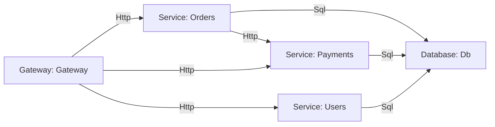

# gateway-microservices

| Arquitectura | `8fK29x` · versión 1 |
|---|---|
| Exportado | 2026-08-16 |
| Motor de análisis | `scoringVersion: v12` |
| Formato | `exportVersion: 3` |

## Diagrama

## Componentes

| Nombre | Tipo | Configuración |
|---|---|---|
| Db | Database | — |
| Orders | Service | — |
| Payments | Service | — |
| Users | Service | — |
| Gateway | Gateway | — |

## Conexiones

| Origen | Destino | Protocolo | Síncrona | Timeout | Reintentos | Circuit breaker | Fallback |
|---|---|---|---|---|---|---|---|
| Gateway | Orders | Http | sí | 5 s | — | no | no |
| Gateway | Payments | Http | sí | 5 s | — | no | no |
| Gateway | Users | Http | sí | 5 s | — | no | no |
| Orders | Db | Sql | sí | 5 s | — | no | no |
| Orders | Payments | Http | sí | — | 3 | no | no |
| Payments | Db | Sql | sí | 5 s | — | no | no |
| Users | Db | Sql | sí | 5 s | — | no | no |

## Análisis

**Puntuación: 87 / 100** · 6 críticos · 3 avisos · 8 reglas superadas

| Área | Puntuación |
|---|---|
| Availability | 75 |
| Resilience | 65 |
| Coupling | 95 |
| Scalability | 100 |
| Security | 100 |
| Observability | 85 |
| Cost | sin reglas aplicables |

### 🔴 SPOF — Availability

**'Db' es un punto único de fallo: 3 componentes dependen de él sin redundancia.**

Si 'Db' cae, se dejan de servir el 100 % de las peticiones que entran por la puerta. No hay ningún componente equivalente que pueda asumir su trabajo.

*Sugerencia:* Añada réplicas con failover automático y verifique que promocionar una nueva primaria no requiere intervención manual. Una réplica de lectura reparte carga; no releva a la primaria cuando cae.

Elementos: `Db`

### 🔴 SPOF — Availability

**'Gateway' es un punto único de fallo: 4 componentes quedan inalcanzables si deja de funcionar.**

Si 'Gateway' cae, se dejan de servir el 100 % de las peticiones que entran por la puerta. No hay ningún componente equivalente que pueda asumir su trabajo.

*Sugerencia:* Declare una segunda instancia, o dibuje dos y sitúelas detrás de un balanceador con comprobación de salud, en zonas distintas. Es el punto de entrada: mientras solo exista uno, todo lo que hay detrás hereda su disponibilidad.

Elementos: `Gateway`

### 🔴 MISSING_RESILIENCE — Resilience

**La llamada de 'Orders' a 'Db' no tiene protección frente a fallos.**

Como 'Db' es un punto único de fallo, su caída se propaga directamente hacia quien lo llama.

*Sugerencia:* Añada un circuit breaker o una respuesta alternativa para cuando el destino no conteste.

Elementos: `Orders → Db`

### 🔴 MISSING_RESILIENCE — Resilience

**La llamada de 'Payments' a 'Db' no tiene protección frente a fallos.**

Como 'Db' es un punto único de fallo, su caída se propaga directamente hacia quien lo llama.

*Sugerencia:* Añada un circuit breaker o una respuesta alternativa para cuando el destino no conteste.

Elementos: `Payments → Db`

### 🔴 MISSING_RESILIENCE — Resilience

**La llamada de 'Users' a 'Db' no tiene protección frente a fallos.**

Como 'Db' es un punto único de fallo, su caída se propaga directamente hacia quien lo llama.

*Sugerencia:* Añada un circuit breaker o una respuesta alternativa para cuando el destino no conteste.

Elementos: `Users → Db`

### 🔴 NO_OBSERVABILITY — Observability

**El sistema está ciego: ninguno de sus 5 componentes está observado.**

No hay ni una sola conexión a la observabilidad en todo el diagrama, así que cuando algo falle no se sabrá qué falló, desde cuándo ni cuál fue la causa. Este hallazgo cubre el sistema entero y se cobra una sola vez: en cuanto conectes el primer componente, este crítico se convierte en un aviso por cada componente que siga sin conectar, y la puntuación del área mejora con cada conexión.

*Sugerencia:* Añada un componente de observabilidad y conéctele los componentes uno a uno, empezando por la puerta de entrada y el sistema de registro: son los dos primeros que habrá que consultar cuando algo falle.

Elementos: `Gateway`, `Users`, `Orders`, `Payments`, `Db`

### 🟡 SPOF — Availability

**'Payments' es un punto único de fallo: 2 componentes dependen de él sin redundancia.**

Si 'Payments' cae, se dejan de servir el 100 % de las peticiones que entran por la puerta. No hay ningún componente equivalente que pueda asumir su trabajo.

*Sugerencia:* Añada una segunda instancia equivalente detrás de un balanceador. Como no guarda estado, sus consumidores no pueden distinguir cuál de las dos ha respondido.

Elementos: `Payments`

### 🟡 RETRY_AMPLIFICATION — Resilience

**La llamada de 'Orders' a 'Payments' reintenta 3 veces sin timeout que las acote.**

Cuando un servicio empieza a fallar, los reintentos de cada salto se multiplican entre sí y añaden carga justo sobre el componente que ya está en dificultades.

*Sugerencia:* Reintente solo en el salto más cercano al fallo, añada esperas crecientes entre intentos y limite los reintentos en los tramos intermedios.

Elementos: `Orders`, `Orders → Payments`, `Payments`

### 🟡 SHARED_DATABASE — Coupling

**'Db' es el almacén compartido de 3 servicios: 'Users', 'Orders', 'Payments'.**

Los servicios que comparten 'Db' no son independientes: el esquema es la interfaz entre ellos, y cambiarlo para uno obliga a tocar a los demás. Cada uno se despliega por separado, pero ninguno puede evolucionar por separado. Es integración por base de datos, el tipo de acoplamiento más difícil de deshacer después.

*Sugerencia:* Asigne a cada servicio sus propios datos, y que los demás se los soliciten por su API o se enteren por una cola. Si dos servicios necesitan las mismas tablas, probablemente son el mismo servicio.

Elementos: `Db`, `Users → Db`, `Orders → Db`, `Payments → Db`

### 🔵 MISSING_CACHE — Scalability

**'Db' recibe consultas directas de 3 componentes sin ninguna caché ni réplica de lectura.**

Toda la carga de lectura recae sobre la misma instancia, que se convierte en el límite de escalado del sistema entero.

*Sugerencia:* Interponga una caché en las lecturas más frecuentes o configure réplicas de lectura en la base de datos.

Elementos: `Db`, `Orders → Db`, `Payments → Db`, `Users → Db`

### 🟢 IMPLAUSIBLE_DEPENDENCY — Resilience

**Cada flecha une dos cosas que pueden hablarse.**

Se ha comprobado, flecha a flecha, que los dos extremos describen una llamada que puede ocurrir realmente: ningún almacén llama a nadie, ningún componente propio llama a los usuarios, el CDN habla con un origen y el planificador dispara trabajo.

### 🟢 SYNC_CHAIN — Resilience

**No hay cadenas síncronas largas.**

Se han recorrido las llamadas síncronas y ninguna encadena suficientes servicios como para que las latencias se sumen.

### 🟢 TIMEOUT_TOO_LONG — Resilience

**Los timeouts son límites, no esperas.**

Cada timeout queda por debajo de lo que el modelo considera una espera sin límite, así que cuando el destino se cuelgue, la llamada fallará a tiempo de que se pueda hacer algo al respecto.

### 🟢 TIMEOUT_TOO_SHORT — Resilience

**Los timeouts dan tiempo a que la llamada termine.**

Cada timeout es mayor que lo que cuesta esa llamada con todo funcionando, así que solo salta cuando algo va mal de verdad.

### 🟢 CYCLE — Coupling

**No hay dependencias circulares.**

Se han seguido las dependencias entre componentes y ninguna vuelve sobre sus pasos: todas se pueden desplegar y arrancar en algún orden.

### 🟢 HIGH_COUPLING — Coupling

**Ningún componente acumula demasiadas dependencias.**

Se ha contado de cuántos componentes depende cada uno, y ninguno necesita tantos como para resultar difícil de desplegar o probar por separado.

### 🟢 ORPHAN_NODE — Coupling

**Todos los componentes están conectados a algo.**

Un componente sin llamadas entrantes ni salientes no participa en ningún flujo, así que ninguna otra regla puede decir nada sobre él.

### 🟢 EXPOSED_DATABASE — Security

**Los datos están detrás de algo.**

Para llegar a los datos hay que pasar antes por una API o un gateway, que es donde se puede comprobar quién llama.

---

## Petición para la IA

Eres un arquitecto de software senior. Arriba tienes una arquitectura, su diagrama y el
resultado de un analizador determinista, con la simulación de un escenario si se ejecutó uno.

Los hallazgos listados **ya son ciertos**: no hace falta que los redescubras ni que los pongas
en duda. Lo que te pido es lo que el analizador no puede hacer:

1. Ordénalos por lo que arreglarías primero, y explica por qué en ese orden.
2. Señala lo que las reglas **no** ven: elección de tecnología, límites entre servicios,
   nombres, o riesgos que no se deducen de la topología.
3. Si algo del diseño te parece correcto aunque el analizador lo penalice, dilo y razónalo.

Sé concreto y usa los nombres de los componentes.
