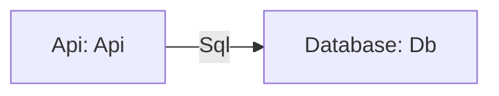

# minimal-api-db

| Arquitectura | `8fK29x` · versión 1 |
|---|---|
| Exportado | 2026-08-16 |
| Motor de análisis | `scoringVersion: v12` |
| Formato | `exportVersion: 3` |

## Diagrama

## Componentes

| Nombre | Tipo | Configuración |
|---|---|---|
| Api | Api | — |
| Db | Database | — |

## Conexiones

| Origen | Destino | Protocolo | Síncrona | Timeout | Reintentos | Circuit breaker | Fallback |
|---|---|---|---|---|---|---|---|
| Api | Db | Sql | sí | 5 s | — | no | no |

## Análisis

**Puntuación: 99 / 100** · 0 críticos · 2 avisos · 12 reglas superadas

| Área | Puntuación |
|---|---|
| Availability | 100 |
| Resilience | 100 |
| Coupling | 100 |
| Scalability | 100 |
| Security | 100 |
| Observability | 93 |
| Cost | sin reglas aplicables |

### 🟡 NO_OBSERVABILITY — Observability

**'Api' no está observado.**

Cuando 'Api' falle no habrá dónde mirar: ningún registro de cuánto tardaba, cuántas peticiones perdió ni si fue quien inició el incidente. La observabilidad no es un componente que se añade: es una conexión por componente, y este no tiene ninguna.

*Sugerencia:* Añada un componente de observabilidad y conéctele 'Api', junto con todo lo demás que convenga poder consultar cuando algo falle.

Elementos: `Api`

### 🟡 NO_OBSERVABILITY — Observability

**'Db' no está observado.**

Cuando 'Db' falle no habrá dónde mirar: ningún registro de cuánto tardaba, cuántas peticiones perdió ni si fue quien inició el incidente. La observabilidad no es un componente que se añade: es una conexión por componente, y este no tiene ninguna.

*Sugerencia:* Añada un componente de observabilidad y conéctele 'Db', junto con todo lo demás que convenga poder consultar cuando algo falle.

Elementos: `Db`

### 🟢 SPOF — Availability

**Ningún componente tiene a varios dependiendo de él sin redundancia.**

Se ha comprobado, componente a componente, qué dejaría de funcionar si cayera: ninguno arrastra a varios otros.

### 🟢 IMPLAUSIBLE_DEPENDENCY — Resilience

**Cada flecha une dos cosas que pueden hablarse.**

Se ha comprobado, flecha a flecha, que los dos extremos describen una llamada que puede ocurrir realmente: ningún almacén llama a nadie, ningún componente propio llama a los usuarios, el CDN habla con un origen y el planificador dispara trabajo.

### 🟢 MISSING_RESILIENCE — Resilience

**Las llamadas síncronas tienen protección frente a fallos.**

Cada llamada síncrona tiene un timeout que la acota y, cuando el destino es crítico, una alternativa por la que salir si no responde.

### 🟢 SYNC_CHAIN — Resilience

**No hay cadenas síncronas largas.**

Se han recorrido las llamadas síncronas y ninguna encadena suficientes servicios como para que las latencias se sumen.

### 🟢 TIMEOUT_TOO_LONG — Resilience

**Los timeouts son límites, no esperas.**

Cada timeout queda por debajo de lo que el modelo considera una espera sin límite, así que cuando el destino se cuelgue, la llamada fallará a tiempo de que se pueda hacer algo al respecto.

### 🟢 TIMEOUT_TOO_SHORT — Resilience

**Los timeouts dan tiempo a que la llamada termine.**

Cada timeout es mayor que lo que cuesta esa llamada con todo funcionando, así que solo salta cuando algo va mal de verdad.

### 🟢 CYCLE — Coupling

**No hay dependencias circulares.**

Se han seguido las dependencias entre componentes y ninguna vuelve sobre sus pasos: todas se pueden desplegar y arrancar en algún orden.

### 🟢 HIGH_COUPLING — Coupling

**Ningún componente acumula demasiadas dependencias.**

Se ha contado de cuántos componentes depende cada uno, y ninguno necesita tantos como para resultar difícil de desplegar o probar por separado.

### 🟢 ORPHAN_NODE — Coupling

**Todos los componentes están conectados a algo.**

Un componente sin llamadas entrantes ni salientes no participa en ningún flujo, así que ninguna otra regla puede decir nada sobre él.

### 🟢 SHARED_DATABASE — Coupling

**Ningún almacén es compartido por varios servicios.**

Cada base de datos y cada almacenamiento de objetos tiene como mucho un servicio que lo usa, así que cada servicio puede cambiar sus datos sin afectar a los demás.

### 🟢 MISSING_CACHE — Scalability

**Los accesos a base de datos están respaldados por caché o réplicas.**

Se ha comprobado quién consulta cada base de datos: ninguna recibe suficiente carga directa como para convertirse en el límite de escalado del sistema.

### 🟢 EXPOSED_DATABASE — Security

**Los datos están detrás de algo.**

Para llegar a los datos hay que pasar antes por una API o un gateway, que es donde se puede comprobar quién llama.

---

## Petición para la IA

Eres un arquitecto de software senior. Arriba tienes una arquitectura, su diagrama y el
resultado de un analizador determinista, con la simulación de un escenario si se ejecutó uno.

Los hallazgos listados **ya son ciertos**: no hace falta que los redescubras ni que los pongas
en duda. Lo que te pido es lo que el analizador no puede hacer:

1. Ordénalos por lo que arreglarías primero, y explica por qué en ese orden.
2. Señala lo que las reglas **no** ven: elección de tecnología, límites entre servicios,
   nombres, o riesgos que no se deducen de la topología.
3. Si algo del diseño te parece correcto aunque el analizador lo penalice, dilo y razónalo.

Sé concreto y usa los nombres de los componentes.
