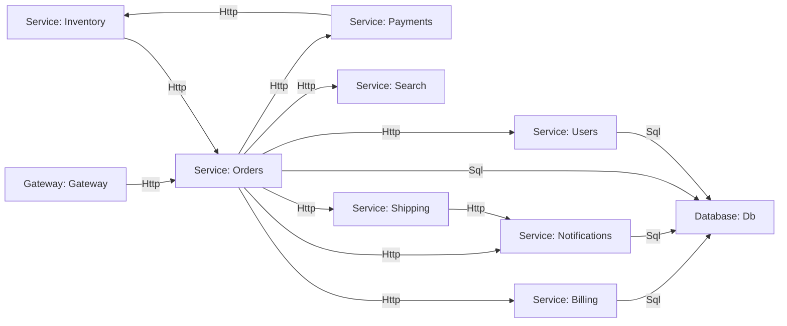

# worst-case

| Arquitectura | `8fK29x` · versión 1 |
|---|---|
| Exportado | 2026-08-16 |
| Motor de análisis | `scoringVersion: v12` |
| Formato | `exportVersion: 3` |

## Diagrama

## Componentes

| Nombre | Tipo | Configuración |
|---|---|---|
| Db | Database | — |
| Billing | Service | — |
| Inventory | Service | — |
| Notifications | Service | — |
| Orders | Service | — |
| Payments | Service | — |
| Search | Service | — |
| Shipping | Service | — |
| Users | Service | — |
| Gateway | Gateway | — |

## Conexiones

| Origen | Destino | Protocolo | Síncrona | Timeout | Reintentos | Circuit breaker | Fallback |
|---|---|---|---|---|---|---|---|
| Billing | Db | Sql | sí | 5 s | — | no | no |
| Gateway | Orders | Http | sí | 5 s | 2 | no | no |
| Inventory | Orders | Http | sí | 5 s | — | no | no |
| Notifications | Db | Sql | sí | 5 s | — | no | no |
| Orders | Billing | Http | sí | 5 s | — | no | no |
| Orders | Db | Sql | sí | 5 s | — | no | no |
| Orders | Notifications | Http | sí | 5 s | — | no | no |
| Orders | Payments | Http | sí | — | — | no | no |
| Orders | Search | Http | sí | 5 s | — | no | no |
| Orders | Shipping | Http | sí | 5 s | 3 | no | no |
| Orders | Users | Http | sí | 5 s | — | no | no |
| Payments | Inventory | Http | sí | 5 s | — | no | no |
| Shipping | Notifications | Http | sí | 5 s | — | no | no |
| Users | Db | Sql | sí | 5 s | — | no | no |

## Análisis

**Puntuación: 76 / 100** · 12 críticos · 4 avisos · 5 reglas superadas

| Área | Puntuación |
|---|---|
| Availability | 68 |
| Resilience | 35 |
| Coupling | 65 |
| Scalability | 100 |
| Security | 100 |
| Observability | 85 |
| Cost | sin reglas aplicables |

### 🔴 SPOF — Availability

**'Db' es un punto único de fallo: 4 componentes dependen de él sin redundancia.**

Si 'Db' cae, se dejan de servir el 100 % de las peticiones que entran por la puerta. No hay ningún componente equivalente que pueda asumir su trabajo.

*Sugerencia:* Añade réplicas con failover automático y verifica que promocionar una nueva primaria no requiere intervención manual. Una réplica de lectura reparte carga; no releva a la primaria cuando cae.

Elementos: `Db`

### 🔴 SPOF — Availability

**'Orders' es un punto único de fallo: 8 componentes quedan inalcanzables si deja de funcionar.**

Si 'Orders' cae, se dejan de servir el 100 % de las peticiones que entran por la puerta. No hay ningún componente equivalente que pueda asumir su trabajo.

*Sugerencia:* Añade una segunda instancia equivalente detrás de un balanceador. Como no guarda estado, sus consumidores no pueden distinguir cuál de las dos les ha respondido.

Elementos: `Orders`

### 🔴 SPOF — Availability

**'Gateway' es un punto único de fallo: 9 componentes quedan inalcanzables si deja de funcionar.**

Si 'Gateway' cae, se dejan de servir el 100 % de las peticiones que entran por la puerta. No hay ningún componente equivalente que pueda asumir su trabajo.

*Sugerencia:* Declárale una segunda instancia, o dibuja dos y ponlas detrás de un balanceador con comprobación de salud, en zonas distintas. Es el punto de entrada: mientras solo exista uno, todo lo que hay detrás hereda su disponibilidad.

Elementos: `Gateway`

### 🔴 MISSING_RESILIENCE — Resilience

**La llamada de 'Billing' a 'Db' no tiene protección frente a fallos.**

Como 'Db' es un punto único de fallo, su caída se propaga directamente hacia quien lo llama.

*Sugerencia:* Añade un circuit breaker o una respuesta alternativa para cuando el destino no conteste.

Elementos: `Billing → Db`

### 🔴 MISSING_RESILIENCE — Resilience

**La llamada de 'Inventory' a 'Orders' no tiene protección frente a fallos.**

Como 'Orders' es un punto único de fallo, su caída se propaga directamente hacia quien lo llama.

*Sugerencia:* Añade un circuit breaker o una respuesta alternativa para cuando el destino no conteste.

Elementos: `Inventory → Orders`

### 🔴 MISSING_RESILIENCE — Resilience

**La llamada de 'Notifications' a 'Db' no tiene protección frente a fallos.**

Como 'Db' es un punto único de fallo, su caída se propaga directamente hacia quien lo llama.

*Sugerencia:* Añade un circuit breaker o una respuesta alternativa para cuando el destino no conteste.

Elementos: `Notifications → Db`

### 🔴 MISSING_RESILIENCE — Resilience

**La llamada de 'Orders' a 'Db' no tiene protección frente a fallos.**

Como 'Db' es un punto único de fallo, su caída se propaga directamente hacia quien lo llama.

*Sugerencia:* Añade un circuit breaker o una respuesta alternativa para cuando el destino no conteste.

Elementos: `Orders → Db`

### 🔴 MISSING_RESILIENCE — Resilience

**La llamada de 'Users' a 'Db' no tiene protección frente a fallos.**

Como 'Db' es un punto único de fallo, su caída se propaga directamente hacia quien lo llama.

*Sugerencia:* Añade un circuit breaker o una respuesta alternativa para cuando el destino no conteste.

Elementos: `Users → Db`

### 🔴 RETRY_AMPLIFICATION — Resilience

**Los reintentos se multiplican a lo largo de la cadena Gateway → Orders → Shipping: hasta 12 peticiones por cada una original.**

Cuando un servicio empieza a fallar, los reintentos de cada salto se multiplican entre sí y añaden carga justo sobre el componente que ya está en dificultades.

*Sugerencia:* Reintenta solo en el salto más cercano al fallo, añade esperas crecientes entre intentos y limita los reintentos en los tramos intermedios.

Elementos: `Gateway`, `Gateway → Orders`, `Orders`, `Orders → Shipping`, `Shipping`

### 🔴 CYCLE — Coupling

**Dependencia circular entre 3 componentes: Orders → Payments → Inventory → Orders.**

Ninguno de los componentes implicados puede desplegarse, arrancar ni recuperarse de forma independiente. Si el ciclo es síncrono, una caída en cualquiera de ellos bloquea a los demás.

*Sugerencia:* Rompe el ciclo con un salto asíncrono: que uno de los pasos publique un evento en lugar de esperar respuesta. Mientras todas las llamadas bloqueen, una caída en cualquiera de los componentes bloquea a los demás.

Elementos: `Orders`, `Orders → Payments`, `Payments`, `Payments → Inventory`, `Inventory`, `Inventory → Orders`, `Orders`

### 🔴 HIGH_COUPLING — Coupling

**'Orders' depende de 7 componentes distintos.**

Un componente que necesita tantas piezas para funcionar es difícil de desplegar, probar y razonar de forma aislada, y su disponibilidad es el producto de la de todos ellos.

*Sugerencia:* Revisa si algunas de esas responsabilidades pertenecen al propio componente, o si parte de las llamadas puede convertirse en eventos asíncronos. Su disponibilidad es el producto de la disponibilidad de todo lo que necesita para responder.

Elementos: `Orders`, `Orders → Billing`, `Orders → Db`, `Orders → Notifications`, `Orders → Payments`, `Orders → Search`, `Orders → Shipping`, `Orders → Users`

### 🔴 NO_OBSERVABILITY — Observability

**El sistema está ciego: ninguno de sus 10 componentes está observado.**

No hay ni una sola conexión a la observabilidad en todo el diagrama, así que cuando algo falle no se sabrá qué falló, desde cuándo ni cuál fue la causa. Este hallazgo cubre el sistema entero y se cobra una sola vez: en cuanto conectes el primer componente, este crítico se convierte en un aviso por cada componente que siga sin conectar, y la puntuación del área mejora con cada conexión.

*Sugerencia:* Añade un componente de observabilidad y conéctale los componentes uno a uno, empezando por la puerta de entrada y el sistema de registro: son los dos que primero querrás mirar cuando algo vaya mal.

Elementos: `Gateway`, `Orders`, `Payments`, `Inventory`, `Shipping`, `Notifications`, `Users`, `Billing`, `Search`, `Db`

### 🟡 SPOF — Availability

**'Notifications' es un punto único de fallo: 2 componentes dependen de él sin redundancia.**

Si 'Notifications' cae, se dejan de servir el 100 % de las peticiones que entran por la puerta. No hay ningún componente equivalente que pueda asumir su trabajo.

*Sugerencia:* Añade una segunda instancia equivalente detrás de un balanceador. Como no guarda estado, sus consumidores no pueden distinguir cuál de las dos les ha respondido.

Elementos: `Notifications`

### 🟡 MISSING_RESILIENCE — Resilience

**La llamada de 'Orders' a 'Payments' no tiene protección frente a fallos.**

Sin timeout, una respuesta lenta retiene recursos indefinidamente.

*Sugerencia:* Configura un timeout acorde a la operación.

Elementos: `Orders → Payments`

### 🟡 SYNC_CHAIN — Resilience

**'Orders' inicia una cadena síncrona de 3 servicios.**

La petición no termina hasta que responde el último eslabón: las latencias se suman y basta con que un eslabón falle para que fallen todos. Se cuentan los componentes que ejecutan lógica —APIs, servicios, workers y terceros—; un CDN, un gateway, un balanceador, una caché o un almacén por el camino son una capa que la llamada atraviesa, no un eslabón más.

*Sugerencia:* Aquí una cola no corta nada: la petición está esperando el dato del final, y una lectura no se puede diferir. Acorta el camino en vez de partirlo: que el componente que responde lea directamente —de una caché o de una réplica alimentada de forma asíncrona—, o fusiona los servicios intermedios si solo pasan la pregunta. Si esta cadena es una escritura, decláralo en la última arista y la solución vuelve a ser una cola.

Elementos: `Orders`, `Orders → Shipping`, `Shipping`, `Shipping → Notifications`, `Notifications`, `Notifications → Db`, `Db`

### 🟡 SHARED_DATABASE — Coupling

**'Db' es el almacén compartido de 4 servicios: 'Orders', 'Notifications', 'Users', 'Billing'.**

Los servicios que comparten 'Db' no son independientes: el esquema es la interfaz entre ellos, y cambiarlo para uno obliga a tocar a los demás. Cada uno se despliega por separado, pero ninguno puede evolucionar por separado. Es integración por base de datos, el tipo de acoplamiento más difícil de deshacer después.

*Sugerencia:* Dale a cada servicio sus propios datos, y que los demás se los pidan por su API o se enteren por una cola. Si dos servicios necesitan las mismas tablas, probablemente son el mismo servicio.

Elementos: `Db`, `Orders → Db`, `Notifications → Db`, `Users → Db`, `Billing → Db`

### 🔵 MISSING_CACHE — Scalability

**'Db' recibe consultas directas de 4 componentes sin ninguna caché ni réplica de lectura.**

Toda la carga de lectura recae sobre la misma instancia, que se convierte en el límite de escalado del sistema entero.

*Sugerencia:* Interpón una caché en las lecturas más frecuentes o configura réplicas de lectura en la base de datos.

Elementos: `Db`, `Billing → Db`, `Notifications → Db`, `Orders → Db`, `Users → Db`

### 🟢 IMPLAUSIBLE_DEPENDENCY — Resilience

**Cada flecha une dos cosas que pueden hablarse.**

Se ha comprobado, flecha a flecha, que los dos extremos describen una llamada que puede ocurrir realmente: ningún almacén llama a nadie, ningún componente tuyo llama a los usuarios, el CDN habla con un origen y el planificador dispara trabajo.

### 🟢 TIMEOUT_TOO_LONG — Resilience

**Los timeouts son límites, no esperas.**

Cada timeout queda por debajo de lo que el modelo considera una espera sin límite, así que cuando el destino se cuelgue, la llamada fallará a tiempo de que se pueda hacer algo al respecto.

### 🟢 TIMEOUT_TOO_SHORT — Resilience

**Los timeouts dan tiempo a que la llamada termine.**

Cada timeout es mayor que lo que cuesta esa llamada con todo funcionando, así que solo salta cuando algo va mal de verdad.

### 🟢 ORPHAN_NODE — Coupling

**Todos los componentes están conectados a algo.**

Un componente sin llamadas entrantes ni salientes no participa en ningún flujo, así que ninguna otra regla puede decir nada sobre él.

### 🟢 EXPOSED_DATABASE — Security

**Los datos están detrás de algo.**

Para llegar a los datos hay que pasar antes por una API o un gateway, que es donde se puede comprobar quién llama.

---

## Petición para la IA

Eres un arquitecto de software senior. Arriba tienes una arquitectura, su diagrama y el
resultado de un analizador determinista, con la simulación de un escenario si se ejecutó uno.

Los hallazgos listados **ya son ciertos**: no hace falta que los redescubras ni que los pongas
en duda. Lo que te pido es lo que el analizador no puede hacer:

1. Ordénalos por lo que arreglarías primero, y explica por qué en ese orden.
2. Señala lo que las reglas **no** ven: elección de tecnología, límites entre servicios,
   nombres, o riesgos que no se deducen de la topología.
3. Si algo del diseño te parece correcto aunque el analizador lo penalice, dilo y razónalo.

Sé concreto y usa los nombres de los componentes.
