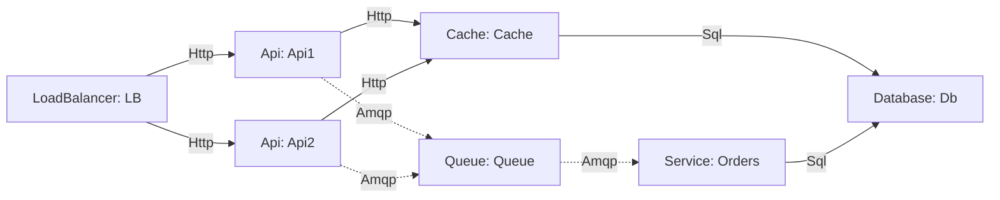

# resilient-async

| | |
|---|---|
| Arquitectura | `8fK29x` · versión 1 |
| Exportado | 2026-08-16 |
| Motor de análisis | `scoringVersion: v4` |
| Formato | `exportVersion: 1` |

## Diagrama

## Componentes

| Nombre | Tipo | Configuración |
|---|---|---|
| Api1 | Api | — |
| Api2 | Api | — |
| Db | Database | — |
| Orders | Service | — |
| Queue | Queue | — |
| Cache | Cache | — |
| LB | LoadBalancer | — |

## Conexiones

| Origen | Destino | Protocolo | Síncrona | Timeout | Reintentos | Circuit breaker | Fallback |
|---|---|---|---|---|---|---|---|
| Api1 | Cache | Http | sí | 1 s | — | no | sí |
| Api1 | Queue | Amqp | no | — | — | no | no |
| Api2 | Cache | Http | sí | 1 s | — | no | sí |
| Api2 | Queue | Amqp | no | — | — | no | no |
| Cache | Db | Sql | sí | 5 s | — | sí | sí |
| LB | Api1 | Http | sí | 3 s | — | sí | no |
| LB | Api2 | Http | sí | 3 s | — | sí | no |
| Orders | Db | Sql | sí | 5 s | — | sí | sí |
| Queue | Orders | Amqp | no | — | — | no | no |

## Análisis

**Puntuación: 92 / 100** · 2 críticos · 6 avisos · 7 reglas superadas

| Área | Puntuación |
|---|---|
| Availability | 90 |
| Resilience | 90 |
| Coupling | 100 |
| Scalability | 100 |
| Security | 78 |
| Observability | 95 |

### 🔴 UNAUTHENTICATED_ENTRY — Security

**'Api1' está expuesto sin autenticación.**

Es una puerta de entrada desde fuera y detrás hay una base de datos, así que cualquiera que conozca la dirección llega a los datos.

*Sugerencia:* Activa la autenticación en el punto de entrada, o pon delante un gateway que la haga.

Elementos: `Api1`

### 🔴 UNAUTHENTICATED_ENTRY — Security

**'Api2' está expuesto sin autenticación.**

Es una puerta de entrada desde fuera y detrás hay una base de datos, así que cualquiera que conozca la dirección llega a los datos.

*Sugerencia:* Activa la autenticación en el punto de entrada, o pon delante un gateway que la haga.

Elementos: `Api2`

### 🟡 SPOF — Availability

**'Db' es un punto único de fallo: 2 componentes dependen de él sin redundancia.**

No existe ningún componente equivalente que pueda asumir su trabajo. Cualquier incidencia en él afecta a todo lo que hay detrás.

*Sugerencia:* Añade un LoadBalancer con al menos dos instancias equivalentes, o replica el componente para que sus consumidores tengan alternativa.

Elementos: `Db`

### 🟡 SPOF — Availability

**'Queue' es un punto único de fallo: 2 componentes dependen de él sin redundancia.**

No existe ningún componente equivalente que pueda asumir su trabajo. Cualquier incidencia en él afecta a todo lo que hay detrás.

*Sugerencia:* Añade un LoadBalancer con al menos dos instancias equivalentes, o replica el componente para que sus consumidores tengan alternativa.

Elementos: `Queue`

### 🟡 SPOF — Availability

**'Cache' es un punto único de fallo: 2 componentes dependen de él sin redundancia.**

No existe ningún componente equivalente que pueda asumir su trabajo. Cualquier incidencia en él afecta a todo lo que hay detrás.

*Sugerencia:* Añade un LoadBalancer con al menos dos instancias equivalentes, o replica el componente para que sus consumidores tengan alternativa.

Elementos: `Cache`

### 🟡 QUEUE_NO_DLQ — Resilience

**'Queue' no tiene dead letter queue.**

Un mensaje que no se puede procesar se reintenta, vuelve a fallar y desaparece sin dejar rastro. Nadie se entera de lo que se ha perdido.

*Sugerencia:* Activa la dead letter queue para que lo que falla quede en algún sitio donde se pueda revisar.

Elementos: `Queue`

### 🟡 SYNC_CHAIN — Resilience

**'LB' inicia una cadena de dependencias síncronas de 4 componentes.**

La petición no termina hasta que responde el último eslabón: las latencias se suman y basta con que uno falle para que fallen todos.

*Sugerencia:* Corta la cadena introduciendo una cola en el punto donde la operación deje de necesitar respuesta inmediata.

Elementos: `LB`, `LB → Api1`, `Api1`, `Api1 → Cache`, `Cache`, `Cache → Db`, `Db`

### 🟡 NO_OBSERVABILITY — Observability

**No hay nada observando la arquitectura.**

Cuando algo falle no habrá dónde mirar: ni qué componente empezó, ni cuánto tardaba, ni cuántas peticiones se perdieron. El fallo se investiga con lo que se recuerde.

*Sugerencia:* Añade un componente de observabilidad y conéctale lo que quieras poder mirar cuando algo vaya mal.

### 🟢 MISSING_RESILIENCE — Resilience

**Las llamadas síncronas tienen protección frente a fallos.**

Cada llamada síncrona tiene un timeout que la acota y, cuando el destino es crítico, una alternativa por la que salir si no responde.

### 🟢 TIMEOUT_TOO_SHORT — Resilience

**Los timeouts dan tiempo a que la llamada termine.**

Cada timeout es mayor que lo que cuesta esa llamada con todo funcionando, así que solo salta cuando algo va mal de verdad.

### 🟢 CYCLE — Coupling

**No hay dependencias circulares.**

Se han seguido las dependencias entre componentes y ninguna vuelve sobre sus pasos: todas se pueden desplegar y arrancar en algún orden.

### 🟢 HIGH_COUPLING — Coupling

**Ningún componente acumula demasiadas dependencias.**

Se ha contado de cuántos componentes depende cada uno y ninguno necesita tantas piezas como para ser difícil de desplegar o probar por separado.

### 🟢 ORPHAN_NODE — Coupling

**Todos los componentes están conectados a algo.**

Un componente sin llamadas entrantes ni salientes no participa en ningún flujo, así que ninguna otra regla puede decir nada sobre él.

### 🟢 MISSING_CACHE — Scalability

**Los accesos a base de datos están respaldados por caché o réplicas.**

Se ha mirado quién consulta cada base de datos: ninguna recibe suficiente carga directa como para convertirse en el límite de escalado del sistema.

### 🟢 EXPOSED_DATABASE — Security

**Las bases de datos están detrás de algo.**

Para llegar a los datos hay que pasar antes por una API o un gateway, que es donde se puede comprobar quién llama.

---

## Petición para la IA

Eres un arquitecto de software senior. Arriba tienes una arquitectura, su diagrama y el
resultado de un analizador determinista, con la simulación de un escenario si se ejecutó uno.

Los hallazgos listados **ya son ciertos**: no hace falta que los redescubras ni que los pongas
en duda. Lo que te pido es lo que el analizador no puede hacer:

1. Ordénalos por lo que arreglarías primero, y explica por qué en ese orden.
2. Señala lo que las reglas **no** ven: elección de tecnología, límites entre servicios,
   nombres, o riesgos que no se deducen de la topología.
3. Si algo del diseño te parece correcto aunque el analizador lo penalice, dilo y razónalo.

Sé concreto y usa los nombres de los componentes.
