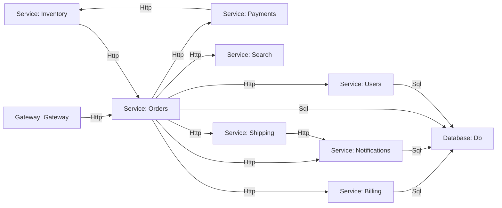

# worst-case

| | |
|---|---|
| Arquitectura | `8fK29x` · versión 1 |
| Exportado | 2026-08-16 |
| Motor de análisis | `scoringVersion: v4` |
| Formato | `exportVersion: 1` |

## Diagrama

## Componentes

| Nombre | Tipo | Configuración |
|---|---|---|
| Db | Database | — |
| Billing | Service | — |
| Inventory | Service | — |
| Notifications | Service | — |
| Orders | Service | — |
| Payments | Service | — |
| Search | Service | — |
| Shipping | Service | — |
| Users | Service | — |
| Gateway | Gateway | — |

## Conexiones

| Origen | Destino | Protocolo | Síncrona | Timeout | Reintentos | Circuit breaker | Fallback |
|---|---|---|---|---|---|---|---|
| Billing | Db | Sql | sí | 5 s | — | no | no |
| Gateway | Orders | Http | sí | 5 s | 2 | no | no |
| Inventory | Orders | Http | sí | 5 s | — | no | no |
| Notifications | Db | Sql | sí | 5 s | — | no | no |
| Orders | Billing | Http | sí | 5 s | — | no | no |
| Orders | Db | Sql | sí | 5 s | — | no | no |
| Orders | Notifications | Http | sí | 5 s | — | no | no |
| Orders | Payments | Http | sí | — | — | no | no |
| Orders | Search | Http | sí | 5 s | — | no | no |
| Orders | Shipping | Http | sí | 5 s | 3 | no | no |
| Orders | Users | Http | sí | 5 s | — | no | no |
| Payments | Inventory | Http | sí | 5 s | — | no | no |
| Shipping | Notifications | Http | sí | 5 s | — | no | no |
| Users | Db | Sql | sí | 5 s | — | no | no |

## Análisis

**Puntuación: 73 / 100** · 13 críticos · 4 avisos · 3 reglas superadas

| Área | Puntuación |
|---|---|
| Availability | 68 |
| Resilience | 25 |
| Coupling | 70 |
| Scalability | 95 |
| Security | 85 |
| Observability | 95 |

### 🔴 SPOF — Availability

**'Db' es un punto único de fallo: 4 componentes dependen de él sin redundancia.**

No existe ningún componente equivalente que pueda asumir su trabajo. Cualquier incidencia en él afecta a todo lo que hay detrás.

*Sugerencia:* Añade un LoadBalancer con al menos dos instancias equivalentes, o replica el componente para que sus consumidores tengan alternativa.

Elementos: `Db`

### 🔴 SPOF — Availability

**'Orders' es un punto único de fallo: 8 componentes quedan inalcanzables si deja de funcionar.**

No existe ningún componente equivalente que pueda asumir su trabajo. Cualquier incidencia en él afecta a todo lo que hay detrás.

*Sugerencia:* Añade un LoadBalancer con al menos dos instancias equivalentes, o replica el componente para que sus consumidores tengan alternativa.

Elementos: `Orders`

### 🔴 SPOF — Availability

**'Gateway' es un punto único de fallo: 9 componentes quedan inalcanzables si deja de funcionar.**

No existe ningún componente equivalente que pueda asumir su trabajo. Cualquier incidencia en él afecta a todo lo que hay detrás.

*Sugerencia:* Añade un LoadBalancer con al menos dos instancias equivalentes, o replica el componente para que sus consumidores tengan alternativa.

Elementos: `Gateway`

### 🔴 MISSING_RESILIENCE — Resilience

**La llamada de 'Billing' a 'Db' no tiene protección frente a fallos.**

Como 'Db' es un punto único de fallo, su caída se propaga directamente hacia atrás.

*Sugerencia:* Añade un circuit breaker o una respuesta alternativa para cuando el destino no conteste.

Elementos: `Billing → Db`

### 🔴 MISSING_RESILIENCE — Resilience

**La llamada de 'Inventory' a 'Orders' no tiene protección frente a fallos.**

Como 'Orders' es un punto único de fallo, su caída se propaga directamente hacia atrás.

*Sugerencia:* Añade un circuit breaker o una respuesta alternativa para cuando el destino no conteste.

Elementos: `Inventory → Orders`

### 🔴 MISSING_RESILIENCE — Resilience

**La llamada de 'Notifications' a 'Db' no tiene protección frente a fallos.**

Como 'Db' es un punto único de fallo, su caída se propaga directamente hacia atrás.

*Sugerencia:* Añade un circuit breaker o una respuesta alternativa para cuando el destino no conteste.

Elementos: `Notifications → Db`

### 🔴 MISSING_RESILIENCE — Resilience

**La llamada de 'Orders' a 'Db' no tiene protección frente a fallos.**

Como 'Db' es un punto único de fallo, su caída se propaga directamente hacia atrás.

*Sugerencia:* Añade un circuit breaker o una respuesta alternativa para cuando el destino no conteste.

Elementos: `Orders → Db`

### 🔴 MISSING_RESILIENCE — Resilience

**La llamada de 'Users' a 'Db' no tiene protección frente a fallos.**

Como 'Db' es un punto único de fallo, su caída se propaga directamente hacia atrás.

*Sugerencia:* Añade un circuit breaker o una respuesta alternativa para cuando el destino no conteste.

Elementos: `Users → Db`

### 🔴 RETRY_AMPLIFICATION — Resilience

**Los reintentos se multiplican a lo largo de la cadena Gateway → Orders → Shipping: hasta 12 peticiones por cada una original.**

Cuando un servicio empieza a fallar, los reintentos de cada salto se multiplican entre sí y aumentan la carga justo sobre el componente que ya está en apuros.

*Sugerencia:* Reintenta solo en el salto más cercano al fallo, añade espera creciente entre intentos y limita los reintentos en los tramos intermedios.

Elementos: `Gateway`, `Gateway → Orders`, `Orders`, `Orders → Shipping`, `Shipping`

### 🔴 SYNC_CHAIN — Resilience

**'Gateway' inicia una cadena de dependencias síncronas de 5 componentes.**

La petición no termina hasta que responde el último eslabón: las latencias se suman y basta con que uno falle para que fallen todos.

*Sugerencia:* Corta la cadena introduciendo una cola en el punto donde la operación deje de necesitar respuesta inmediata.

Elementos: `Gateway`, `Gateway → Orders`, `Orders`, `Orders → Shipping`, `Shipping`, `Shipping → Notifications`, `Notifications`, `Notifications → Db`, `Db`

### 🔴 CYCLE — Coupling

**Dependencia circular entre 3 componentes: Orders → Payments → Inventory → Orders.**

Ninguno de los componentes implicados puede desplegarse, arrancar ni recuperarse de forma independiente. Si el ciclo es síncrono, una caída en cualquiera de ellos bloquea a los demás.

*Sugerencia:* Rompe el ciclo invirtiendo una de las dependencias o sustituyéndola por comunicación asíncrona vía cola.

Elementos: `Orders`, `Orders → Payments`, `Payments`, `Payments → Inventory`, `Inventory`, `Inventory → Orders`, `Orders`

### 🔴 HIGH_COUPLING — Coupling

**'Orders' depende de 7 componentes distintos.**

Un componente que necesita tantas piezas para funcionar es difícil de desplegar, probar y razonar de forma aislada, y su disponibilidad es el producto de la de todos ellos.

*Sugerencia:* Revisa si algunas de esas responsabilidades pertenecen al propio componente, o si parte de las llamadas puede pasar a eventos asíncronos.

Elementos: `Orders`, `Orders → Billing`, `Orders → Db`, `Orders → Notifications`, `Orders → Payments`, `Orders → Search`, `Orders → Shipping`, `Orders → Users`

### 🔴 UNAUTHENTICATED_ENTRY — Security

**'Gateway' está expuesto sin autenticación.**

Es una puerta de entrada desde fuera y detrás hay una base de datos, así que cualquiera que conozca la dirección llega a los datos.

*Sugerencia:* Activa la autenticación en el punto de entrada, o pon delante un gateway que la haga.

Elementos: `Gateway`

### 🟡 SPOF — Availability

**'Notifications' es un punto único de fallo: 2 componentes dependen de él sin redundancia.**

No existe ningún componente equivalente que pueda asumir su trabajo. Cualquier incidencia en él afecta a todo lo que hay detrás.

*Sugerencia:* Añade un LoadBalancer con al menos dos instancias equivalentes, o replica el componente para que sus consumidores tengan alternativa.

Elementos: `Notifications`

### 🟡 MISSING_RESILIENCE — Resilience

**La llamada de 'Orders' a 'Payments' no tiene protección frente a fallos.**

Sin timeout, una respuesta lenta retiene recursos indefinidamente.

*Sugerencia:* Configura un timeout acorde a la operación.

Elementos: `Orders → Payments`

### 🟡 MISSING_CACHE — Scalability

**'Db' recibe consultas directas de 4 componentes sin ninguna caché ni réplica de lectura.**

Toda la carga de lectura recae sobre la misma instancia, que se convierte en el límite de escalado del sistema entero.

*Sugerencia:* Interpón una caché en las lecturas más frecuentes o configura réplicas de lectura en la base de datos.

Elementos: `Db`, `Billing → Db`, `Notifications → Db`, `Orders → Db`, `Users → Db`

### 🟡 NO_OBSERVABILITY — Observability

**No hay nada observando la arquitectura.**

Cuando algo falle no habrá dónde mirar: ni qué componente empezó, ni cuánto tardaba, ni cuántas peticiones se perdieron. El fallo se investiga con lo que se recuerde.

*Sugerencia:* Añade un componente de observabilidad y conéctale lo que quieras poder mirar cuando algo vaya mal.

### 🟢 TIMEOUT_TOO_SHORT — Resilience

**Los timeouts dan tiempo a que la llamada termine.**

Cada timeout es mayor que lo que cuesta esa llamada con todo funcionando, así que solo salta cuando algo va mal de verdad.

### 🟢 ORPHAN_NODE — Coupling

**Todos los componentes están conectados a algo.**

Un componente sin llamadas entrantes ni salientes no participa en ningún flujo, así que ninguna otra regla puede decir nada sobre él.

### 🟢 EXPOSED_DATABASE — Security

**Las bases de datos están detrás de algo.**

Para llegar a los datos hay que pasar antes por una API o un gateway, que es donde se puede comprobar quién llama.

---

## Petición para la IA

Eres un arquitecto de software senior. Arriba tienes una arquitectura, su diagrama y el
resultado de un analizador determinista, con la simulación de un escenario si se ejecutó uno.

Los hallazgos listados **ya son ciertos**: no hace falta que los redescubras ni que los pongas
en duda. Lo que te pido es lo que el analizador no puede hacer:

1. Ordénalos por lo que arreglarías primero, y explica por qué en ese orden.
2. Señala lo que las reglas **no** ven: elección de tecnología, límites entre servicios,
   nombres, o riesgos que no se deducen de la topología.
3. Si algo del diseño te parece correcto aunque el analizador lo penalice, dilo y razónalo.

Sé concreto y usa los nombres de los componentes.
